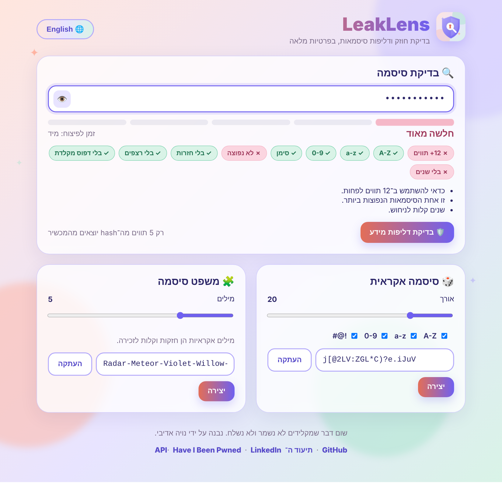

<div dir="rtl">

<p align="center">
  <a href="https://noyaadivi.github.io/LeakLens/?lang=he"></a>
</p>

<p align="center"><a href="README.md"></a></p>

<p align="center">
  <a href="https://noyaadivi.github.io/LeakLens/?lang=he"></a>
  <a href="#-api-at-a-glance"></a>
  <a href="docs/SECURITY.he.md"></a>
</p>

<p align="center">
  <a href="https://github.com/NoyaAdivi/LeakLens/actions/workflows/tests.yml"></a>
  <a href="LICENSE"></a>
  <a href="https://github.com/NoyaAdivi/LeakLens/commits/main"></a>
  <a href="https://github.com/NoyaAdivi/LeakLens"></a>
</p>

<h3 align="center">לבדוק סיסמה בלי למסור אותה לאף אחד.</h3>

<p align="center">
  LeakLens הוא REST API שמדרג את חוזק הסיסמה, בודק אם היא הופיעה בדליפות מידע ויוצר סיסמאות מאובטחות.<br>
  הסיסמה לא נשמרת, לא נרשמת ביומן ולא נשלחת לשום מקום. רק 5 תווים מה־hash שלה יוצאים מהשרת.
</p>

<table align="center">
  <tr>
    <td align="center" width="25%"><a href="#-how-your-password-stays-private"><b>🔐 5 תווים</b></a><br><sub>זה כל מה שיוצא</sub></td>
    <td align="center" width="25%"><a href="#-api-at-a-glance"><b>⚡ 7</b></a><br><sub>נקודות REST</sub></td>
    <td align="center" width="25%"><a href="https://noyaadivi.github.io/LeakLens/?lang=he"><b>🌍 HE · EN</b></a><br><sub>כל הודעה בשתי השפות</sub></td>
    <td align="center" width="25%"><a href="https://github.com/NoyaAdivi/LeakLens/actions/workflows/tests.yml"><b>🧪 CI</b></a><br><sub>בדיקות בכל דחיפה</sub></td>
  </tr>
</table>

<a name="-what-it-does"></a>
<p align="center"><a href="#-how-your-password-stays-private"></a></p>

<table dir="rtl">
  <tr valign="top">
    <td width="50%">
      <p><b>💪 ניתוח חוזק</b></p>
      <ul>
        <li><b>ציון בין 0 ל־4</b> עם אנטרופיה בביטים והערכה של זמן הפיצוח</li>
        <li><b>מזהה חולשות אמיתיות:</b> סיסמאות נפוצות, החלפת אותיות בסימנים (<code>P@ssw0rd</code>), רצפים, חזרות, דפוסי מקלדת ושנים</li>
        <li><b>טיפים ברורים</b> בעברית או באנגלית איך לחזק את הסיסמה</li>
      </ul>
    </td>
    <td width="50%">
      <p><b>🕵️ בדיקת דליפות</b></p>
      <ul>
        <li>חיפוש ב־<a href="https://haveibeenpwned.com/Passwords"><b>Have I Been Pwned</b></a>, מאגר של מאות מיליוני סיסמאות שדלפו</li>
        <li><b>k-anonymity:</b> נשלחים רק 5 התווים הראשונים של hash מסוג SHA-1</li>
        <li><b>נקודה שמקבלת רק hash</b>, ללקוחות שלא רוצים לשלוח את הסיסמה בכלל</li>
      </ul>
    </td>
  </tr>
  <tr valign="top">
    <td width="50%">
      <p><b>🎲 מחולל סיסמאות</b></p>
      <ul>
        <li>מבוסס על המודול <a href="https://docs.python.org/3/library/secrets.html"><code>secrets</code></a> של Python, מקור אקראיות מאובטח קריפטוגרפית</li>
        <li>תמיד כולל את כל סוגי התווים שבחרת, ואז מערבב</li>
        <li>אפשר לוותר על תווים שנראים דומים, כמו <code>l</code>, <code>1</code>, <code>O</code> ו־<code>0</code></li>
      </ul>
    </td>
    <td width="50%">
      <p><b>🧩 משפטי סיסמה</b></p>
      <ul>
        <li>מילים אקראיות כמו <code>Maple-Comet-Otter-Prism-42</code>, חזקות וקלות לזכירה</li>
        <li>בוחרים את מספר המילים ואת התו המפריד</li>
        <li>כל תוצאה מגיעה עם האנטרופיה שלה, כך שאפשר למדוד את החוזק</li>
      </ul>
    </td>
  </tr>
</table>

<a name="-how-your-password-stays-private"></a>
<p align="center"><a href="#-api-at-a-glance"></a></p>

<p align="center">
  <a href="https://haveibeenpwned.com/API/v3#PwnedPasswords"></a>
</p>

<p align="center"><sub>HIBP מקבל רק <code>5BAA6</code>, תחילית שמשותפת למאות סיסמאות שונות, ולכן הוא לא יכול לדעת איזו סיסמה נבדקה. התשובות מרופדות, כך שגם הגודל שלהן לא מסגיר כלום.</sub></p>

<a name="-api-at-a-glance"></a>
<p align="center"><a href="#-try-it-in-your-browser"></a></p>

| שיטה | נקודה | מה היא עושה |
|---|---|---|
| `POST` | `/v1/strength` | ציון, אנטרופיה, זמן פיצוח, בדיקות וטיפים |
| `POST` | `/v1/pwned` | בדיקת דליפות לסיסמה, בשיטת k-anonymity |
| `POST` | `/v1/pwned/hash` | בדיקת דליפות לפי hash מסוג SHA-1 שנוצר אצלך |
| `POST` | `/v1/check` | חוזק ודליפות יחד, עם תשובה סופית `safe` |
| `POST` | `/v1/generate` | סיסמה אקראית מאובטחת |
| `POST` | `/v1/passphrase` | משפט סיסמה ממילים אקראיות |
| `GET` | `/health` | מצב השירות |

כל בקשה מקבלת `"lang": "he"` או `"lang": "en"`. התיעוד האינטראקטיבי נפתח ב־`/docs` אחרי שהשרת עולה.

<details>
<summary><b>📬 דוגמה לבקשה ולתשובה</b></summary>
<br>

```bash
curl -X POST http://localhost:8000/v1/check \
  -H "Content-Type: application/json" \
  -d '{"password": "Summer2024!", "lang": "he"}'
```

```json
{
  "safe": false,
  "strength": {
    "score": 0,
    "label": "חלשה מאוד",
    "entropy_bits": 10.0,
    "crack_time_display": "מיד",
    "checks": { "length_12": false, "not_common": false, "no_years": false, "...": true },
    "feedback": ["זו אחת הסיסמאות הנפוצות ביותר. כדאי לבחור משהו אחר.", "..."]
  },
  "breach": { "pwned": true, "count": 4216, "message": "הסיסמה הזו הופיעה בדליפות מידע. אסור להשתמש בה." }
}
```
<sub>מספר הדליפות כאן להמחשה. המספרים האמיתיים גדלים ככל שמתווספות דליפות חדשות.</sub>
</details>

<a name="-try-it-in-your-browser"></a>
<p align="center"><a href="https://noyaadivi.github.io/LeakLens/?lang=he"></a></p>

<p align="center">
  <a href="https://noyaadivi.github.io/LeakLens/?lang=he"></a>
</p>

<p align="center">
  <a href="https://noyaadivi.github.io/LeakLens/?lang=he"><b>לפתוח בעברית</b></a> ·
  <a href="https://noyaadivi.github.io/LeakLens/?lang=en"><b>לפתוח באנגלית</b></a> ·
  <a href="docs/index.html"><b>קוד המקור</b></a>
</p>

<p align="center"><sub>מגרש המשחקים מריץ את אותם כללים ב־JavaScript, מחשב hash עם Web Crypto של הדפדפן ופונה ל־HIBP ישירות. בלי שרת ובלי מעקב.</sub></p>

<a name="-security-by-design"></a>
<p align="center"><a href="#-tech-stack"></a></p>

| הגנה | איך |
|---|---|
| הסיסמה לא נשמרת ולא נרשמת | נשמרת ב־`SecretStr` של Pydantic, אין מסד נתונים, יומן הגישה כבוי ב־Docker |
| שום דבר לא נשמר בדפדפן או בשרתי ביניים | `Cache-Control: no-store` בכל תשובה של `/v1` |
| ניחוש בכוח ושימוש לרעה | הגבלת קצב לכל IP עם חלון נע, תשובת `429` עם `Retry-After` |
| בקשות גדולות מדי | גוף מעל 4KB נדחה עם `413`, וסיסמה מוגבלת ל־256 תווים |
| התקפות דפדפן | `nosniff`, חסימת הטמעה במסגרת, CSP קפדני, `no-referrer`, HSTS |
| קריאות מאתרים אחרים | CORS סגור כברירת מחדל, ונפתח רק לאתרים שמגדירים |
| קונטיינר | תמונה רזה שרצה כמשתמש בלי הרשאות root |

עוד פרטים ב־[docs/SECURITY.he.md](docs/SECURITY.he.md).

<a name="-tech-stack"></a>
<p align="center"><a href="#-run-it-locally"></a></p>

<p align="center"><b>API</b><br>
<a href="https://www.python.org"></a>
<a href="https://fastapi.tiangolo.com"></a>
<a href="https://docs.pydantic.dev"></a>
<a href="https://www.python-httpx.org"></a>
</p>

<p align="center"><b>אבטחה</b><br>
<a href="https://haveibeenpwned.com/API/v3#PwnedPasswords"></a>
<a href="https://docs.python.org/3/library/secrets.html"></a>
<a href="https://developer.mozilla.org/en-US/docs/Web/API/Web_Crypto_API"></a>
</p>

<p align="center"><b>השקה</b><br>
<a href="https://docs.pytest.org"></a>
<a href="https://github.com/NoyaAdivi/LeakLens/actions"></a>
<a href="https://www.docker.com"></a>
<a href="https://pages.github.com"></a>
</p>

<a name="-run-it-locally"></a>
<p align="center"><a href="#contact"></a></p>

1. התקנה והפעלה:
   ```bash
   python -m venv .venv
   .venv\Scripts\activate        # במק או בלינוקס: source .venv/bin/activate
   pip install -r requirements-dev.txt
   uvicorn app.main:app --reload
   ```
2. פותחים את [http://localhost:8000/docs](http://localhost:8000/docs) ומנסים כל נקודה.
3. מריצים את הבדיקות:
   ```bash
   pytest -q
   ```
4. או עם Docker:
   ```bash
   docker build -t leaklens .
   docker run -p 8000:8000 leaklens
   ```

ההגדרות נמצאות ב־[`.env.example`](.env.example): הגבלת הקצב והאתרים שמורשים לפנות ל־API מהדפדפן.

<details>
<summary><b>📂 מבנה הפרויקט</b></summary>

```
├── app/
│   ├── main.py        אפליקציית FastAPI, מודלים ונתיבים
│   ├── strength.py    דירוג חוזק, זיהוי דפוסים, זמן פיצוח
│   ├── pwned.py       SHA-1, חיפוש k-anonymity, מטמון עם תפוגה
│   ├── generator.py   סיסמאות ומשפטי סיסמה מאובטחים
│   ├── security.py    כותרות אבטחה, הגבלת קצב, הגבלת גודל
│   ├── messages.py    כל ההודעות בעברית ובאנגלית
│   └── data/          סיסמאות נפוצות ורשימת המילים
├── tests/             בדיקות pytest (לוגיקה ו־API)
├── docs/
│   ├── index.html     מגרש המשחקים החי (GitHub Pages)
│   ├── SECURITY.md    מודל האבטחה
│   └── readme/        העיצובים של ה־README
├── .github/workflows/ CI
└── Dockerfile
```
</details>

<details>
<summary><b>🙏 קרדיטים</b></summary>
<br>
נתוני הדליפות מגיעים מ־<a href="https://haveibeenpwned.com">Have I Been Pwned</a> של Troy Hunt, דרך ה־API החינמי של Pwned Passwords, ברישיון <a href="https://creativecommons.org/licenses/by/4.0/">CC BY 4.0</a>.
</details>

<a name="contact"></a>
<p align="center"><a href="https://www.linkedin.com/in/noya-adivi/"></a></p>

<p align="center">
  <a href="https://noyaadivi.github.io/LeakLens/?lang=he"></a>
  <a href="https://www.linkedin.com/in/noya-adivi/"></a>
  <a href="https://noyaadivi.github.io/noya-website"></a>
  <a href="https://github.com/NoyaAdivi"></a>
</p>

</div>
