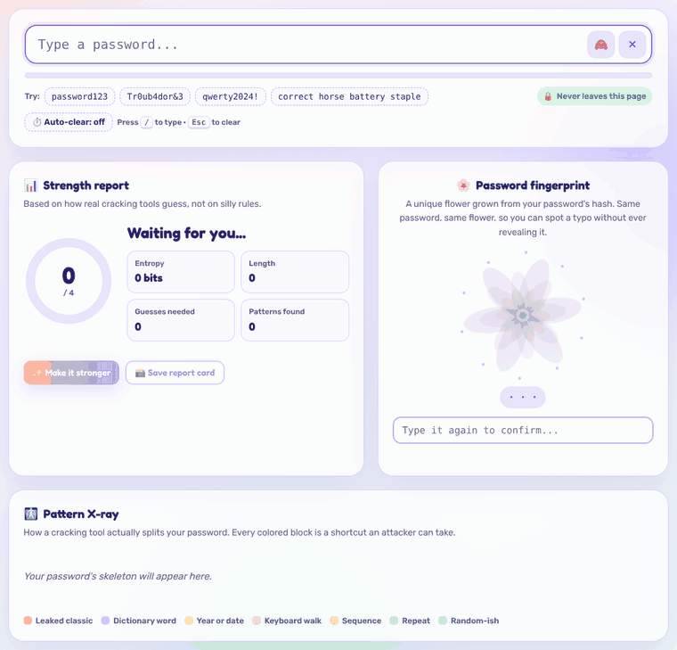
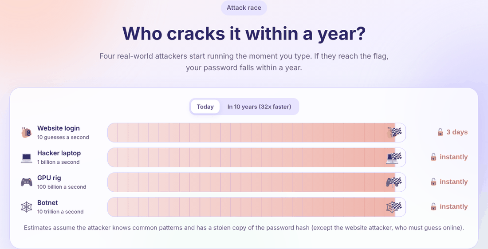

<p align="center">
  <a href="https://noyaadivi.github.io/LeakLens/"></a>
</p>

<p align="center"><a href="README.he.md"></a></p>

<p align="center">
  <a href="https://noyaadivi.github.io/LeakLens/"></a>
  <a href="#-api-at-a-glance"></a>
  <a href="docs/SECURITY.md"></a>
</p>

<p align="center">
  <a href="https://github.com/NoyaAdivi/LeakLens/actions/workflows/tests.yml"></a>
  <a href="LICENSE"></a>
  <a href="https://github.com/NoyaAdivi/LeakLens/commits/main"></a>
  <a href="https://github.com/NoyaAdivi/LeakLens"></a>
</p>

<h3 align="center">Check a password without ever giving it away.</h3>

<p align="center">
  LeakLens is an interactive security lab and a REST API: it X-rays password patterns, races them against real attackers, checks data breaches and generates secure passwords.<br>
  Your password is never stored, never logged and never sent anywhere. Only 5 characters of its hash leave the server.
</p>

<table align="center">
  <tr>
    <td align="center" width="25%"><a href="#-how-your-password-stays-private"><b>🔐 5 chars</b></a><br><sub>the only thing that leaves</sub></td>
    <td align="center" width="25%"><a href="#-api-at-a-glance"><b>⚡ 7</b></a><br><sub>REST endpoints</sub></td>
    <td align="center" width="25%"><a href="https://noyaadivi.github.io/LeakLens/?lang=he"><b>🌍 HE · EN</b></a><br><sub>every message, both languages</sub></td>
    <td align="center" width="25%"><a href="#-try-it-in-your-browser"><b>🏁 4</b></a><br><sub>attackers in the live race</sub></td>
  </tr>
</table>

<a name="-what-it-does"></a>
<p align="center"><a href="#-how-your-password-stays-private"></a></p>

<table>
  <tr valign="top">
    <td width="50%">
      <p><b>💪 Strength analysis</b></p>
      <ul>
        <li><b>Score from 0 to 4</b> with entropy in bits and an estimated time to crack</li>
        <li><b>Catches real weaknesses:</b> common passwords, leetspeak (<code>P@ssw0rd</code>), sequences, repeats, keyboard patterns and years</li>
        <li><b>Clear tips</b> in English or Hebrew on how to make it stronger</li>
      </ul>
    </td>
    <td width="50%">
      <p><b>🕵️ Breach check</b></p>
      <ul>
        <li>Searches <a href="https://haveibeenpwned.com/Passwords"><b>Have I Been Pwned</b></a>, a database of hundreds of millions of leaked passwords</li>
        <li><b>k-anonymity:</b> only the first 5 characters of a SHA-1 hash are sent</li>
        <li><b>Hash-only endpoint</b> for clients that never want to send the password at all</li>
      </ul>
    </td>
  </tr>
  <tr valign="top">
    <td width="50%">
      <p><b>🎲 Password generator</b></p>
      <ul>
        <li>Built on Python's <a href="https://docs.python.org/3/library/secrets.html"><code>secrets</code></a> module, a cryptographically secure random source</li>
        <li>Always includes every character group you chose, then shuffles</li>
        <li>Option to skip look-alike characters such as <code>l</code>, <code>1</code>, <code>O</code> and <code>0</code></li>
      </ul>
    </td>
    <td width="50%">
      <p><b>🧩 Passphrases</b></p>
      <ul>
        <li>Random words like <code>Maple-Comet-Otter-Prism-42</code>, strong and easy to remember</li>
        <li>Choose the number of words and the separator</li>
        <li>Every result reports its entropy, so strength is measurable</li>
      </ul>
    </td>
  </tr>
</table>

<a name="app"></a>
<h3 align="center">📲 App and FAQ <sub><sup>new</sup></sub></h3>
<p align="center">LeakLens installs as a real app with its own icon, and the site answers common questions by topic.</p>

<table>
  <tr valign="top">
    <td width="50%">
      <ul>
        <li><b>📲 Installable app (PWA):</b> its own icon and window on phone and desktop, named just LeakLens</li>
        <li><b>⚡ Works offline</b> after the first visit, powered by a service worker</li>
      </ul>
    </td>
    <td width="50%">
      <ul>
        <li><b><a href="https://noyaadivi.github.io/LeakLens/?lang=en#faq">❓ FAQ by topic</a>:</b> filter chips, search with highlighting and smooth animations</li>
        <li><b>🔗 Built by Noya Adivi</b> with a LinkedIn link at the bottom of every page</li>
      </ul>
    </td>
  </tr>
</table>


<a name="-how-your-password-stays-private"></a>
<p align="center"><a href="#-api-at-a-glance"></a></p>

<p align="center">
  <a href="https://haveibeenpwned.com/API/v3#PwnedPasswords"></a>
</p>

<p align="center"><sub>HIBP gets only <code>5BAA6</code>, a prefix shared by hundreds of different passwords, so it can't tell which one you checked. Responses are padded so even their size gives nothing away.</sub></p>

<a name="-api-at-a-glance"></a>
<p align="center"><a href="#-try-it-in-your-browser"></a></p>

| Method | Endpoint | What it does |
|---|---|---|
| `POST` | `/v1/strength` | Score, entropy, crack time, checks and tips |
| `POST` | `/v1/pwned` | Breach check for a password, using k-anonymity |
| `POST` | `/v1/pwned/hash` | Breach check from a SHA-1 hash made on your side |
| `POST` | `/v1/check` | Strength and breach check together, with a final `safe` verdict |
| `POST` | `/v1/generate` | Secure random password |
| `POST` | `/v1/passphrase` | Random-word passphrase |
| `GET` | `/health` | Service status |

Every body accepts `"lang": "en"` or `"lang": "he"`. Interactive docs open at `/docs` once the server is running.

<details>
<summary><b>📬 Example request and response</b></summary>
<br>

```bash
curl -X POST http://localhost:8000/v1/check \
  -H "Content-Type: application/json" \
  -d '{"password": "Summer2024!", "lang": "en"}'
```

```json
{
  "safe": false,
  "strength": {
    "score": 0,
    "label": "Very weak",
    "entropy_bits": 10.0,
    "crack_time_display": "instantly",
    "checks": { "length_12": false, "not_common": false, "no_years": false, "...": true },
    "feedback": ["This is one of the most common passwords. Choose something else.", "..."]
  },
  "breach": { "pwned": true, "count": 4216, "message": "This password appeared in data breaches. Never use it." }
}
```
<sub>The breach count is illustrative. Real numbers grow as new leaks are added.</sub>
</details>

<a name="-try-it-in-your-browser"></a>
<p align="center"><a href="https://noyaadivi.github.io/LeakLens/"></a></p>

<p align="center">
  <a href="https://noyaadivi.github.io/LeakLens/"></a>
</p>

<table>
  <tr valign="top">
    <td width="50%"><p><b>🔎 Leak lens hero</b></p>A magnifying glass that follows your cursor and reveals real leaked passwords hiding in a wall of random characters. Tap to shuffle.</td>
    <td width="50%"><p><b>🩻 Pattern X-ray</b></p>Your password split into colored blocks exactly like a cracking tool sees it: leaked classics, dictionary words, years, keyboard walks, sequences and repeats.</td>
  </tr>
  <tr valign="top">
    <td width="50%"><p><b>🏁 Attack race</b></p>Four attackers (website login, laptop, GPU rig, botnet) race to crack it within a year. Switch to <b>In 10 years</b> to see how faster hardware changes the result.</td>
    <td width="50%"><p><b>🌸 Fingerprint flower</b></p>A unique flower and 3 words grown from the SHA-256 hash. Same password, same flower, so you can spot a typo while the field stays hidden. A confirm field checks the match.</td>
  </tr>
  <tr valign="top">
    <td width="50%"><p><b>✨ Make it stronger + 📸 report card</b></p>One click upgrades a weak password with random words. Save a shareable PNG report card that never contains the password.</td>
    <td width="50%"><p><b>🎰 Password slot machine</b></p>Spinning reels pick random words with <code>crypto.getRandomValues</code>, or switch to random characters. Copy, send to the lab, or reuse from the recent list.</td>
  </tr>
  <tr valign="top">
    <td width="50%"><p><b>🕵️ Animated leak check</b></p>Watch the 5-character prefix travel to HIBP and the padded list come back, then the match happens on your device.</td>
    <td width="50%"><p><b>🛡️ Privacy extras</b></p>Auto-clear after 60 seconds, Caps Lock warning, <kbd>/</kbd> and <kbd>Esc</kbd> shortcuts, dark mode, Hebrew and English, and a draggable accessibility menu.</td>
  </tr>
</table>

<p align="center">
  <a href="https://noyaadivi.github.io/LeakLens/#arena"></a>
</p>

<p align="center">
  <a href="https://noyaadivi.github.io/LeakLens/"><b>Open in English</b></a> ·
  <a href="https://noyaadivi.github.io/LeakLens/?lang=he"><b>Open in Hebrew</b></a> ·
  <a href="docs/index.html"><b>Source</b></a>
</p>

<p align="center"><sub>The playground runs the same rules in JavaScript, hashes with the browser's Web Crypto API and talks to HIBP directly. No server, no tracking.</sub></p>

<a name="-security-by-design"></a>
<p align="center"><a href="#-tech-stack"></a></p>

| Protection | How |
|---|---|
| Password never stored or logged | Kept in a Pydantic `SecretStr`, no database, access logs off in Docker |
| Nothing cached in browsers or proxies | `Cache-Control: no-store` on every `/v1` response |
| Brute force and abuse | Per-IP sliding window rate limit, `429` with `Retry-After` |
| Oversized requests | Bodies over 4 KB are rejected with `413`, passwords capped at 256 characters |
| Browser attacks | `nosniff`, `DENY` framing, strict CSP, `no-referrer`, HSTS |
| Cross-site calls | CORS closed by default, opened only for sites you list |
| Container | Slim image, runs as a non-root user |

More in [docs/SECURITY.md](docs/SECURITY.md).

<a name="-tech-stack"></a>
<p align="center"><a href="#-run-it-locally"></a></p>

<p align="center"><b>API</b><br>
<a href="https://www.python.org"></a>
<a href="https://fastapi.tiangolo.com"></a>
<a href="https://docs.pydantic.dev"></a>
<a href="https://www.python-httpx.org"></a>
</p>

<p align="center"><b>Security</b><br>
<a href="https://haveibeenpwned.com/API/v3#PwnedPasswords"></a>
<a href="https://docs.python.org/3/library/secrets.html"></a>
<a href="https://developer.mozilla.org/en-US/docs/Web/API/Web_Crypto_API"></a>
</p>

<p align="center"><b>Ship</b><br>
<a href="https://docs.pytest.org"></a>
<a href="https://github.com/NoyaAdivi/LeakLens/actions"></a>
<a href="https://www.docker.com"></a>
<a href="https://pages.github.com"></a>
</p>

<a name="-run-it-locally"></a>
<p align="center"><a href="#contact"></a></p>

1. Install and start:
   ```bash
   python -m venv .venv
   .venv\Scripts\activate        # on Mac or Linux: source .venv/bin/activate
   pip install -r requirements-dev.txt
   uvicorn app.main:app --reload
   ```
2. Open [http://localhost:8000/docs](http://localhost:8000/docs) and try every endpoint.
3. Run the tests:
   ```bash
   pytest -q
   ```
4. Or with Docker:
   ```bash
   docker build -t leaklens .
   docker run -p 8000:8000 leaklens
   ```

Settings live in [`.env.example`](.env.example): the rate limit and the sites allowed to call the API from a browser.

<details>
<summary><b>📂 Project structure</b></summary>

```
├── app/
│   ├── main.py        FastAPI app, models and routes
│   ├── strength.py    strength scoring, pattern detection, crack time
│   ├── pwned.py       SHA-1, k-anonymity range lookup, TTL cache
│   ├── generator.py   secure passwords and passphrases
│   ├── security.py    security headers, rate limiting, body size cap
│   ├── messages.py    every message in English and Hebrew
│   └── data/          common passwords and the passphrase word list
├── tests/             pytest suite (core logic and API)
├── docs/
│   ├── index.html     the live lab (GitHub Pages)
│   ├── noya-kit.js    shared accessibility menu and dark mode
│   ├── images/        screenshots, demo GIFs, social previews
│   ├── SECURITY.md    security model
│   └── readme/        README art
├── .github/workflows/ CI
└── Dockerfile
```
</details>

<details>
<summary><b>🙏 Attribution</b></summary>
<br>
Breach data from <a href="https://haveibeenpwned.com">Have I Been Pwned</a> by Troy Hunt, used through the free Pwned Passwords range API under <a href="https://creativecommons.org/licenses/by/4.0/">CC BY 4.0</a>.
</details>

<a name="contact"></a>
<p align="center"><a href="https://www.linkedin.com/in/noya-adivi/"></a></p>

<p align="center">
  <a href="https://noyaadivi.github.io/LeakLens/"></a>
  <a href="https://www.linkedin.com/in/noya-adivi/"></a>
  <a href="https://noyaadivi.github.io/noya-website"></a>
  <a href="https://github.com/NoyaAdivi"></a>
</p>
